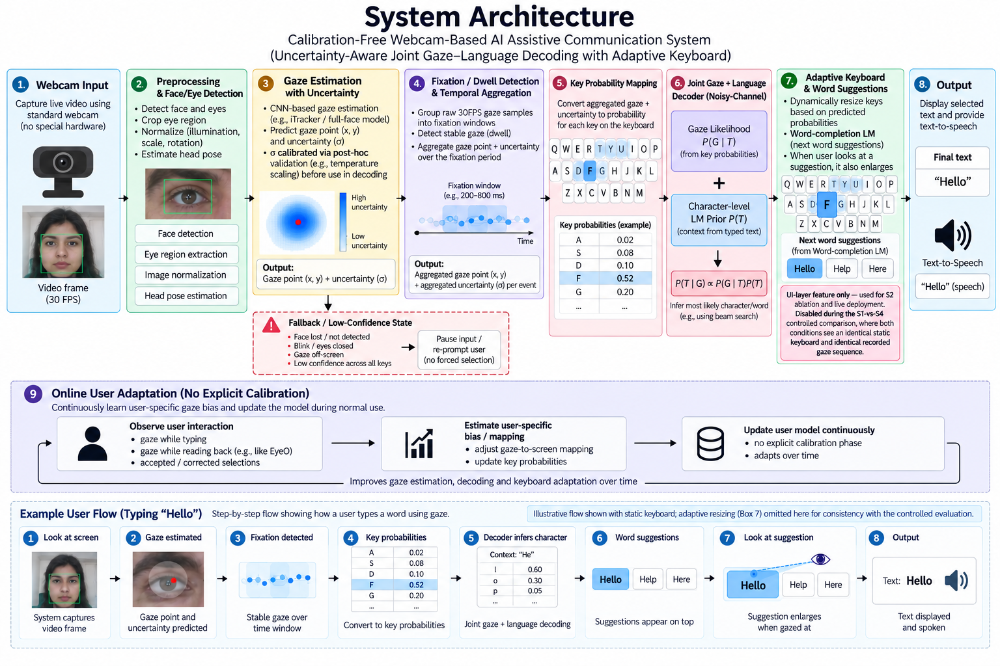

# Calibration-Free Webcam Gaze Decoding for Assistive Communication Using Language Models

### Master Project Document

**Project title:** Calibration-Free Eye-Gaze Typing System for Speech-Impaired and Motor-Disabled Users Using Webcam and AI
**Research title:** Uncertainty-Aware Calibration-Free Webcam Gaze Decoding for Assistive Communication Using Language Models
**Domain:** Computer Science / AI-ML — Assistive Technology (AAC)
**SIH theme:** MedTech / BioTech / HealthTech
**SDG alignment:** SDG 3 (Good Health and Well-being), SDG 10 (Reduced Inequalities), SDG 9 (Industry, Innovation and Infrastructure — secondary)

This single document consolidates everything produced for this project: the problem statement, the complete 12-paper literature survey, the research gap, the system design and innovation, the full system architecture, the experimental design, the research hypotheses, and the complete phased implementation roadmap (including Groq API integration). Nothing from the frozen project design has been left out.

---

## Table of Contents

1. [Problem Statement](#1-problem-statement)
2. [Literature Survey — 12 Papers, 2016–2025](#2-literature-survey--12-papers-20162025)
3. [Final Research Gap](#3-final-research-gap)
4. [Final System Definition](#4-final-system-definition)
5. [Core Innovation](#5-core-innovation)
6. [Three Core Contributions (C1–C3)](#6-three-core-contributions-c1c3)
7. [System Architecture](#7-system-architecture)
8. [Stage-by-Stage Description](#8-stage-by-stage-description)
9. [Role of the Adaptive Keyboard and the Language Model](#9-role-of-the-adaptive-keyboard-and-the-language-model)
10. [Experimental Design (S0 → S4)](#10-experimental-design-s0--s4)
11. [Research Hypotheses](#11-research-hypotheses)
12. [Final Project Identity](#12-final-project-identity)
13. [Groq API Integration Strategy](#13-groq-api-integration-strategy)
14. [Tech Stack](#14-tech-stack)
15. [Software Architecture (Repository Layout)](#15-software-architecture-repository-layout)
16. [Communication Protocol (WebSocket)](#16-communication-protocol-websocket)
17. [Datasets](#17-datasets)
18. [Metrics](#18-metrics)
19. [The 13 Development Phases](#19-the-13-development-phases)
20. [Suggested Timeline (14-Week Semester)](#20-suggested-timeline-14-week-semester)
21. [What NOT to Add](#21-what-not-to-add)
22. [Final Master Flow](#22-final-master-flow)
23. [Final Caution and Status](#23-final-caution-and-status)

---

## 1. Problem Statement

People with severe motor and speech impairments — caused by conditions such as ALS, cerebral palsy, spinal injury, and locked-in syndrome — cannot use a keyboard, mouse, touchscreen, or speech to communicate, and depend on eye-gaze typing. However, existing gaze-typing solutions rely either on expensive dedicated eye-tracker hardware or on webcam-based systems that require a tedious per-user calibration step, which must be repeated over time and fails under natural head movement and changing lighting. This makes affordable, reliable communication inaccessible to most who need it, especially in home and low-resource settings.

> This project proposes a **calibration-free, webcam-only eye-gaze typing system** that uses an AI language-model-assisted decoder to reconstruct accurate, full sentences from noisy, low-precision gaze input — enabling reliable hands-free text communication on an ordinary laptop, with no special hardware and no calibration, thereby advancing SDG 3 (Good Health and Well-being) and SDG 10 (Reduced Inequalities).

---

## 2. Literature Survey — 12 Papers, 2016–2025

12 papers, organized into 4 thematic sets of 3 papers each. Every citation below was verified (year, authors, venue, key results, and link) before inclusion.

### SET 1 — Webcam-Based Gaze Estimation
*Establishes that ordinary cameras can estimate gaze at all — but leaves accuracy, uncertainty-use, and calibration open.*

#### 1.1 — Eye Tracking for Everyone
- **Link:** https://openaccess.thecvf.com/content_cvpr_2016/papers/Krafka_Eye_Tracking_for_CVPR_2016_paper.pdf
- **Year:** 2016
- **Author & Where:** Krafka, Khosla, Kellnhofer, Kannan, Bhandarkar, Matusik, Torralba — MIT / U. Georgia / MPI Informatik — **CVPR 2016**
- **Dataset:** GazeCapture — 2,445,504 frames, 1,474 subjects, crowdsourced via iOS app + Amazon Mechanical Turk + in-lab recruitment
- **Proposed Methodology:** End-to-end multi-region CNN ("iTracker") taking left eye, right eye, full face, and a face-grid location mask as four parallel inputs, fused via FC layers
- **Method:** AlexNet-scale CNN regression, Euclidean loss on (x,y) gaze position in camera-centred cm; knowledge-distilled compact model for real-time mobile inference (10–15fps)
- **Output:** 2D gaze point (cm from camera); 1.71cm (phone) / 2.53cm (tablet) error without calibration
- **Advantages:** Largest gaze dataset of its time (~30x more subjects than prior work); works on unmodified consumer hardware; strong cross-dataset generalisation
- **Disadvantages:** Still centimetre-level error without calibration; targets phones/tablets, not laptop webcams; single deterministic point output, no uncertainty; no typing/AAC task
- **Research Gap (for our project):** Gives a calibration-free CNN backbone, but no gaze uncertainty, no keyboard interface, and no language-model coupling — exactly what our project adds

#### 1.2 — It's Written All Over Your Face: Full-Face Appearance-Based Gaze Estimation
- **Link:** https://arxiv.org/abs/1611.08860
- **Year:** 2017
- **Author & Where:** Zhang, Sugano, Fritz, Bulling — MPI Informatik / Osaka University — **CVPR Workshops 2017**
- **Dataset:** MPIIGaze (213,659 real-world images, 15 users), EYEDIAP
- **Proposed Methodology:** Full-face-only CNN with a learned "spatial weights" mechanism that suppresses irrelevant regions and enhances informative facial regions per sample
- **Method:** AlexNet backbone + 3 extra 1×1 conv/ReLU layers generating a spatial weight map, applied by element-wise multiplication to conv feature maps before regression
- **Output:** 2D/3D gaze direction (angular error, degrees); 4.8° person-independent 3D error on MPIIGaze
- **Advantages:** 14.3% (MPIIGaze) / 27.7% (EYEDIAP) error reduction over iTracker; more robust to extreme head pose & illumination; single-image input, no separate eye crops
- **Disadvantages:** Requires a calibrated camera + geometric image-normalisation pipeline for 3D estimation; no interaction/typing task; accuracy still condition-dependent
- **Research Gap (for our project):** Improves raw estimation accuracy and robustness, but never addresses deployment on an uncalibrated laptop webcam or any communication/AAC application

#### 1.3 — Gaze360: Physically Unconstrained Gaze Estimation in the Wild
- **Link:** https://openaccess.thecvf.com/content_ICCV_2019/html/Kellnhofer_Gaze360_Physically_Unconstrained_Gaze_Estimation_in_the_Wild_ICCV_2019_paper.html
- **Year:** 2019
- **Author & Where:** Kellnhofer, Chan, Hoffman, Mitra, Durand, Torralba — MIT — **ICCV 2019**
- **Dataset:** Gaze360 — 238 subjects, indoor + outdoor scenes, wide head-pose / camera-distance range
- **Proposed Methodology:** Temporal (multi-frame) gaze estimation model that explicitly predicts a per-sample **uncertainty** alongside the gaze direction
- **Method:** LSTM-based sequence encoder over consecutive video frames → 3D gaze vector + confidence/uncertainty estimate
- **Output:** 3D gaze direction with an explicit predicted uncertainty value
- **Advantages:** One of the first large-scale models to output calibrated per-sample uncertainty, not just a point estimate; handles wide head-pose/distance variation well
- **Disadvantages:** Uncertainty is reported but never consumed by any downstream decision-making or interaction system; no typing/communication application
- **Research Gap (for our project):** Confirms webcam-class gaze uncertainty is measurable and meaningful — but it is discarded after estimation; our decoder is designed to actually use it

---

### SET 2 — Calibration-Free / Adaptive Gaze Estimation
*Reduces or reframes the calibration burden — but none eliminate it while also feeding a downstream decoder.*

#### 2.1 — Few-Shot Adaptive Gaze Estimation (FAZE)
- **Link:** https://arxiv.org/abs/1905.01941
- **Year:** 2019
- **Author & Where:** Park, De Mello, Molchanov, Iqbal, Hilliges, Kautz — NVIDIA / ETH Zürich — **ICCV 2019**
- **Dataset:** GazeCapture (meta-training), MPIIGaze (evaluation)
- **Proposed Methodology:** Rotation-aware disentangling encoder-decoder separating appearance, head pose, and gaze in a latent space, combined with meta-learning (MAML) for fast person-specific adaptation
- **Method:** Encoder-decoder pretraining for disentanglement + MAML-trained adaptable estimator, fine-tuned per user with a handful of labelled samples
- **Output:** Person-adapted 3D gaze direction — 3.18° error with as few as 3 calibration samples (19% improvement over prior art)
- **Advantages:** Cuts calibration from a full 9–13-point session to 3–9 samples; strong few-shot accuracy; open-sourced code
- **Disadvantages:** Still needs explicit labelled calibration samples — not truly calibration-free; no text-entry/AAC application; adaptation is offline, not from natural interaction
- **Research Gap (for our project):** Shows how little labelled data personalisation needs, but our project removes even this — adapting from natural typing interaction with no dedicated calibration phase at all

#### 2.2 — Offset Calibration for Appearance-Based Gaze Estimation via Gaze Decomposition
- **Link:** https://arxiv.org/abs/1905.04451
- **Year:** 2020
- **Author & Where:** Chen, Shi — Hong Kong University of Science and Technology — **WACV 2020**
- **Dataset:** MPIIGaze, EYEDIAP, ColumbiaGaze
- **Proposed Methodology:** Decomposes predicted gaze angle into a subject-independent term (CNN) + a subject-dependent bias term, motivated by inter-subject bias exceeding intra-subject variance
- **Method:** CNN estimates the subject-independent component; bias term set to zero for calibration-free mode, or estimated from a few images at one gaze point for low-cost calibration
- **Output:** Calibration-free mode beats prior SOTA by up to 10%; single-point calibration (~9 samples) cuts error by up to 35.6%
- **Advantages:** Cleanly separates "what generalises" from "what is personal"; strong calibration-free baseline plus an optional very-low-cost calibration path; results across 3 datasets
- **Disadvantages:** Subject-dependent bias is simply discarded in calibration-free mode rather than estimated implicitly from use; no interaction/typing task evaluated
- **Research Gap (for our project):** The bias-decomposition idea parallels our online user-adaptation component, but is never connected to an interactive system that learns bias from natural use or language-assisted decoding

#### 2.3 — EyeO: Autocalibrating Gaze Output with Gaze Input for Gaze Typing
- **Link:** https://www.microsoft.com/en-us/research/publication/eyeo-autocalibrating-gaze-output-with-gaze-input-for-gaze-typing/
- **Year:** 2025
- **Author & Where:** Saran, Alber, Zhang, Paradiso, Bragg, Langford — Microsoft Research — **CHI EA 2025**
- **Dataset:** 20-participant user study + semi-structured interviews with 6 ALS community stakeholders (dedicated eye-tracker hardware)
- **Proposed Methodology:** Exploits the behavioural difference between gaze-as-input (typing — user compensates for miscalibration) and gaze-as-output (reading typed text — user does not compensate) to silently recalibrate
- **Method:** Tracks fixations on the last-typed character while the user reads it back; compares predicted gaze to the character's known screen location to correct calibration offset in real time
- **Output:** Continuously self-correcting calibration offset; significant gains in typing efficiency and reported user experience
- **Advantages:** Genuinely seamless, in-background recalibration with no separate calibration session; validated with ALS stakeholder input; most recent, closest precedent to "no explicit calibration phase"
- **Disadvantages:** Built for a dedicated eye tracker, not an ordinary webcam; produces a corrected point estimate, not a probability distribution; no coupling with a language model
- **Research Gap (for our project):** Closest existing system to our calibration-free philosophy — but it recalibrates a point estimate; it never preserves gaze uncertainty or feeds a joint gaze+language decoder

---

### SET 3 — Gaze-Based Text Entry / Virtual Keyboards
*Solves interaction/typing mechanics, but assumes accurate input or specialised interaction, not noisy webcam probability distributions.*

#### 3.1 — EyeSwipe: Dwell-free Text Entry Using Gaze Paths
- **Link:** https://doi.org/10.1145/2858036.2858335
- **Year:** 2016
- **Author & Where:** Kurauchi, Feng, Joshi, Morimoto, Betke — Boston University / U. São Paulo — **CHI 2016**
- **Dataset:** In-lab user study, dedicated eye tracker
- **Problem:** Traditional dwell-based gaze typing is slow: for every character the user must Look → Stay → Select → Move → Stay → Select, which is also tiring for users who rely on gaze as their primary input channel.
- **Proposed Methodology:** Word-level "swipe" text entry — the user's gaze path across a word's letters is interpreted as the intended word, instead of dwelling on each letter
- **Method:** Gaze-path tracing + reverse-crossing selection gesture to mark word start/end; word recognised by matching path shape to dictionary candidates
- **Output:** Typed word; ~11.7 WPM after practice
- **Advantages:** Shows interaction/decoding strategy — not just gaze accuracy — strongly affects typing speed; dwell-free approach reduces fatigue vs. per-letter dwell; demonstrates gaze can behave like a gesture/path input, not only a static pointer
- **Disadvantages:** Requires a dedicated eye tracker and calibration; the reverse-crossing gesture is unnatural and needs user practice; limited generalisability to webcams/other users/environments (inferred, not an explicit author claim)
- **Research Gap (for our project):** Establishes that path/word-level decoding beats per-letter dwell — a principle our noisy-channel decoder generalises to per-key probability distributions from an uncalibrated webcam, without a special gesture vocabulary

#### 3.2 — SliceType: Fast Gaze Typing with a Merging Keyboard
- **Link:** https://arxiv.org/abs/1706.02499
- **Year:** 2018 (arXiv 2017)
- **Author & Where:** Benligiray, Topal, Akinlar — Anadolu University / Eskisehir Technical University — **Journal on Multimodal User Interfaces 13(4)**
- **Dataset:** 37 novice users, in-lab comparison vs. Dasher and GazeTalk
- **Problem:** Gaze typing is slow because keyboards have many small keys and the user must accurately fixate on individual letters; can the keyboard itself adapt to what the user is statistically likely to type next?
- **Proposed Methodology:** Adaptive "merging" keyboard — a language model predicts unlikely next keys, which shrink/disappear, and the freed space merges into adjacent likely keys, enlarging them
- **Method:** Per-key language-model-driven size adaptation; inline word-completion predictions shown directly at each key so the user reads them while dwelling; design validated using Fitts' Law analysis
- **Output:** Typed text; faster and more preferred than Dasher/GazeTalk in the 37-user study
- **Advantages:** Directly shows confidence/probability-aware key sizing improves gaze-typing speed and comfort — a core building block of a confidence-aware-keyboard ablation stage; uses language proactively to reshape the interface, not just correct output afterward
- **Disadvantages:** Still assumes a reasonably accurate, calibrated gaze signal and dedicated eye-tracking hardware; improves the interface layer only, not gaze-uncertainty handling; no webcam or calibration-free evaluation
- **Research Gap (for our project):** Validates confidence-aware keyboard adaptation as an interface technique — our project extends the same principle deeper, into the decoder, using the full probability distribution

#### 3.3 — Calibration-free Text Entry using Smooth Pursuit Eye Movements
- **Link:** https://doi.org/10.1145/3314111.3319838
- **Year:** 2019
- **Author & Where:** Abdrabou, Mostafa, Khamis, Elmougy — German University in Cairo / U. Glasgow / U. Canada in Egypt — **ETRA 2019**
- **Dataset:** In-lab study (dedicated eye tracker), N = 26 participants; text suggestions trained on a 10,000-sentence corpus
- **Problem:** Traditional eye trackers require an explicit calibration procedure; can users enter text with their eyes with no traditional calibration step at all?
- **Proposed Methodology:** Calibration-free gaze typing via smooth-pursuit motion correlation — the user tracks a moving target letter, and gaze-trajectory correlation with each candidate's motion selects it, needing no absolute-position calibration
- **Method:** Motion-correlation matching (no fixed calibration mapping) + corpus-trained text suggestions
- **Output:** Typed text; 3.41 WPM (N=26), improved from 3.34 WPM prior smooth-pursuit baseline (SMOOVS)
- **Advantages:** Strongest existing precedent combining calibration-free gaze typing with language-based text suggestions in one system — proves the combination is viable; true calibration-free operation
- **Disadvantages:** Requires continuously moving on-screen stimuli, a fundamentally different interaction paradigm from static-keyboard pointing; dedicated eye tracker, not webcam; relatively low throughput
- **Research Gap (for our project):** Closest calibration-free-typing-plus-language precedent overall — but is architecturally smooth-pursuit, not a webcam static-keyboard system with a joint uncertainty-aware decoder

---

### SET 4 — Language-Model-Assisted AAC
*Shows LLMs sharply improve AAC text entry, but always sits downstream of an already-working gaze-input mechanism.*

#### 4.1 — Using LLMs to Accelerate Communication for Eye Gaze Typing Users with ALS (SpeakFaster)
- **Link:** https://doi.org/10.1038/s41467-024-53873-3
- **Year:** 2024
- **Author & Where:** Cai, Venugopalan, Seaver, Xiao, Tomanek, Jalasutram, Morris, Kane, Narayanan, MacDonald, Kornman, Vance, Casey, Gleason, Nelson, Brenner — Google Research / Team Gleason Foundation / Harvard — **Nature Communications**
- **Dataset:** Offline simulation + mobile pilot (19 non-AAC users) + lab/field study, 2 eye-gaze ALS AAC users using Tobii eye trackers
- **Proposed Methodology:** Fine-tuned LLM expands highly-abbreviated input (word initials + occasional extra letters) into full, contextually appropriate phrases
- **Method:** KeywordAE + FillMask LLM pathway integrated into an existing Tobii-based eye-gaze keyboard UI
- **Output:** Full expanded phrases from abbreviated gaze-typed input; 57% fewer motor actions in simulation; 29–60% higher text-entry rate in 2 ALS eye-gaze users
- **Advantages:** Strongest real-world evidence to date that an LLM meaningfully accelerates eye-gaze AAC communication for ALS users; rigorously field-tested, not just simulated
- **Disadvantages:** Entirely assumes a pre-existing, accurate, dedicated eye-tracker input pipeline — solves the downstream text-expansion problem only; ignores noisy/calibration-free webcam gaze
- **Research Gap (for our project):** Clearest evidence LLMs help AAC — but starts from clean gaze input. Our project solves the complementary upstream problem: useful text from noisy, calibration-free webcam gaze

#### 4.2 — Adapting Large Language Models for Character-based Augmentative and Alternative Communication
- **Link:** https://arxiv.org/abs/2501.10582
- **Year:** 2025
- **Author & Where:** arXiv preprint 2501.10582 — 2025
- **Dataset:** Character-level AAC simulation / synthetic typing traces (no real AAC-user training data, as noted by the authors)
- **Proposed Methodology:** Adapts an LLM to predict the next character (not word/phrase) for AAC users typing one letter at a time — useful when only limited/noisy input is available per keystroke
- **Method:** LLM fine-tuning/adaptation for character-level next-token prediction in an AAC typing context
- **Output:** Predicted next character(s) to accelerate one-letter-at-a-time AAC typing
- **Advantages:** Operates at exactly the character granularity our decoder needs (vs. SpeakFaster's word/phrase-level abbreviation expansion); recent and directly relevant
- **Disadvantages:** Character-by-character LLM prediction can be computationally expensive in real time; lacks real AAC-user training data; assumes clean, already-selected characters as input
- **Research Gap (for our project):** Confirms character-level LLM prediction is viable for AAC, but — like SpeakFaster — consumes already-decided characters, not a noisy probabilistic per-key signal jointly decoded with language

#### 4.3 — "The less I type, the better": How AI Language Models can Enhance or Impede Communication for AAC Users
- **Link:** https://doi.org/10.1145/3544548.3581560
- **Year:** 2023
- **Author & Where:** Valencia, Cave, Kallarackal, Seaver, Terry, Kane — Carnegie Mellon University / Google Research — **CHI 2023**
- **Dataset:** User study with AAC users evaluating live LLM suggestions across 3 scenarios (short replies, biographical Qs, requesting assistance)
- **Proposed Methodology:** Empirically evaluates how real-time LLM text suggestions affect AAC communication quality and authenticity, not just speed
- **Method:** Live LLM-suggestion integration into an AAC interface; qualitative + quantitative user evaluation
- **Output:** Mixed findings — LLM suggestions can speed communication, but users worried suggestions did not reflect their own voice/style
- **Advantages:** Provides a human-centred caution missing from purely technical AAC papers: LLM assistance is not an unconditional good and must preserve user identity in output text
- **Disadvantages:** Studies an existing AAC interface with conventional (non-gaze, non-webcam) input; does not address gaze estimation or calibration at all
- **Research Gap (for our project):** A necessary reminder for our evaluation design — our decoder must be judged not only on WPM/accuracy, but on whether reconstructed text still reflects the user's intended meaning

---

## 3. Final Research Gap

### Short version (for slides / PPT)

> Webcam gaze estimation, calibration-free gaze interaction, gaze-based text entry, and LLM-assisted AAC have each been explored separately. However, existing approaches commit to a single gaze point or selected character before language processing. The use of an uncertain gaze distribution from an ordinary webcam directly in language-based text decoding, without an explicit calibration phase, remains insufficiently explored.

### Formal version (for the report / paper)

> Prior work has separately advanced webcam-based gaze estimation, calibration-free and adaptive gaze estimation, gaze-based text entry, and language-model-assisted AAC. However, these approaches generally pass a hard-selected gaze point or character to downstream interaction or language components. Although gaze uncertainty can be estimated, it is not directly incorporated into a language-based text decoder. This leaves an open question of whether preserving webcam-derived gaze uncertainty and jointly decoding it with linguistic context, without an explicit per-user calibration phase, can improve the reliability of gaze-based communication.

### Evidence supporting the gap, by literature pillar

| Pillar | Representative Paper | What It Shows | What It Leaves Open |
|---|---|---|---|
| Webcam gaze estimation | Gaze360 (Kellnhofer et al., 2019) | Predicts per-sample gaze uncertainty alongside direction | Uncertainty is reported but never consumed downstream |
| Gaze-based text entry | SliceType (Benligiray et al., 2018) | Uses language probability to reshape the keyboard interface | Language acts at the interface level only, not inside the decoder |
| Calibration-free / adaptive gaze | EyeO (Saran et al., 2025) | Performs seamless implicit recalibration during natural use | Still outputs a corrected point estimate, not a distribution |
| LLM-assisted AAC | SpeakFaster (Cai et al., 2024); Character-level AAC (2025) | LLM meaningfully accelerates AAC text entry | LLM always operates on already hard-selected input |

**Caution:** based on these 12 papers, the defensible claim is that *"the reviewed papers do not evaluate this specific combination,"* not that *"no existing paper does this."* A final targeted literature search immediately before paper submission should re-verify the gap still holds, and novelty should be phrased as *"to the best of our knowledge…"*

---

## 4. Final System Definition

> A webcam-based assistive communication system that estimates gaze and its uncertainty, converts the uncertainty into a probability distribution over keyboard keys, and jointly decodes this distribution with linguistic context to produce intended text, while continuously adapting to individual user gaze behaviour without requiring an explicit calibration session.

### Simplified flow

```
Normal Webcam
      ↓
Gaze Estimation
      ↓
Gaze + Uncertainty
      ↓
Probability for each keyboard key
      ↓
Gaze Probabilities + Language Context
      ↓
Joint Decoder
      ↓
Intended Text
      ↓
Text / Speech Output
```

---

## 5. Core Innovation

This project does **not** claim to have invented webcam gaze estimation, calibration-free gaze, gaze typing, adaptive keyboards, or LLM-assisted AAC — each already exists in the literature reviewed above. The innovation is the **connection** between them:

> Instead of forcing uncertain webcam gaze into one key first, we preserve its probability distribution and jointly decode it with a language model.

**Traditional pipeline:**
```
Webcam → Gaze → "D" (hard selection) → Language correction → Text
```

**Our system:**
```
Webcam → Gaze → [A=0.05, S=0.10, D=0.50, F=0.25, G=0.10]
      → (Language context + Gaze probabilities) → Decoder → "D"
```

The difference is *where* the language model enters the process — after a hard decision has already been made (traditional), versus jointly with the raw uncertainty (ours).

---

## 6. Three Core Contributions (C1–C3)

### C1 — Uncertainty-Aware Gaze Representation

Instead of outputting only *"the user is looking at D,"* the system represents *"D is most likely, but F and G are also possible."* This converts the raw gaze estimate into a full probability distribution over keyboard keys, rather than a single committed point.

### C2 — Joint Gaze + Language Decoding ⭐ (Main Research Contribution)

Gaze likelihood and language-model probability are combined to determine the intended character/word, following a noisy-channel decoding formulation:

```
P(T | G)  ∝  P(G | T) · P(T)
```

- **G** = observed gaze (the key-probability distribution)
- **T** = candidate text
- **P(G|T)** = how well the candidate text explains the observed gaze probabilities (gaze likelihood)
- **P(T)** = how likely that text is according to the language model (language prior)

This is essentially a **noisy-channel decoding approach**, analogous to how speech recognition or spelling correction systems combine an imperfect signal with a language prior. **The LM isn't merely correcting the final text — it participates in the decision.**

### C3 — Online User Adaptation (Secondary Contribution)

The system gradually learns the user's gaze behaviour instead of requiring a separate calibration session, grounded directly in the literature survey:

| Precedent | What It Contributes to C3 |
|---|---|
| FAZE (Park et al., 2019) | Shows that only a few user-specific samples can meaningfully improve gaze estimation |
| Chen & Shi (2020) | Explicitly models a subject-dependent gaze bias term separate from the subject-independent estimate |
| EyeO (Saran et al., 2025) | Demonstrates seamless in-use recalibration using gaze-while-typing vs. gaze-while-reading-back behaviour |

```
User interacts → System observes reliable interactions → Estimate user's gaze bias
      → Update user model → Better decoding
```

C3 is **secondary** to C1/C2 — it strengthens the system but is not the central research claim.

---

## 7. System Architecture



**Figure — Final system architecture:** 8-stage main pipeline (webcam capture through output), the online user-adaptation loop (no explicit calibration), and a worked example flow for typing the word "Hello."

### Architecture components (as depicted above)

1. **Webcam Input** — capture live video using a standard webcam, no special hardware, 30 FPS
2. **Preprocessing & Face/Eye Detection** — face detection, eye region extraction, image normalization (illumination/scale/rotation), head pose estimation
3. **Gaze Estimation with Uncertainty** — CNN-based gaze estimation (iTracker / full-face model), predicts gaze point (x, y) and uncertainty (σ), calibrated via post-hoc validation (e.g. temperature scaling) before use in decoding
4. **Fixation / Dwell Detection & Temporal Aggregation** — groups raw 30 FPS gaze samples into fixation windows (e.g. 200–800 ms), detects stable gaze (dwell), aggregates gaze point + uncertainty over the fixation period into one selection-event distribution
5. **Key Probability Mapping** — converts aggregated gaze + uncertainty to a probability for each key on the keyboard
6. **Joint Gaze + Language Decoder (Noisy-Channel)** — combines Gaze Likelihood P(G|T) with a Character-level LM Prior P(T) (context from typed text) via P(T|G) ∝ P(G|T)·P(T), inferring the most likely character/word (e.g. using beam search)
7. **Adaptive Keyboard & Word Suggestions** — dynamically resizes keys based on predicted probabilities; a separate Word-completion LM (next-word suggestions) enlarges suggestions the user gazes toward. *This is a UI-layer feature only — used for the S2 ablation and live deployment. It is disabled during the S1-vs-S4 controlled comparison, where both conditions must see an identical static keyboard and identical recorded gaze sequence.*
8. **Output** — displays the selected text and provides text-to-speech

**Fallback / Low-Confidence State** (branches off Stage 3/4): triggered by face lost/not detected, blink/eyes closed, gaze off-screen, or low confidence across all keys → the system pauses input / re-prompts the user rather than forcing a selection.

**Online User Adaptation** (Stage 9, continuous loop): observes user interaction (gaze while typing, gaze while reading back — EyeO-style, accepted/corrected selections) → estimates user-specific bias/mapping → updates the user model continuously, with no explicit calibration phase, improving gaze estimation, decoding, and keyboard adaptation over time.

---

## 8. Stage-by-Stage Description

### Stage 1 — Gaze Estimation
Use a webcam-based gaze model. The literature provides suitable foundations such as iTracker / full-face CNN approaches (Krafka et al., 2016; Zhang et al., 2017), while Gaze360 (Kellnhofer et al., 2019) provides the key precedent for estimating uncertainty alongside the point prediction.

### Stage 2 — Estimate Uncertainty
Instead of only obtaining a point (x, y), the system must obtain (x, y) + uncertainty, then determine how much of that uncertainty falls over each keyboard key.

```
(x, y)  →  (x, y) + uncertainty (σ)
```

Conceptually, gaze is modelled as G ~ N(μ, Σ) around the predicted point, and for each key Kᵢ:

```
P(Kᵢ | G) = ∫_{Kᵢ} p(g | μ, Σ) dg
```

### Stage 3 — Key Probability Distribution
Example distribution produced for a single selection event:

| Key | Probability |
|---|---|
| A | 0.02 |
| S | 0.08 |
| D | 0.52 |
| F | 0.30 |
| G | 0.08 |

This distribution becomes the direct input to the joint decoder (Stage 5).

### Stage 4 — Language Model Prior
The language model looks at text already produced, e.g. the partial phrase *"I am go…"*:

| Candidate next character | Language-model likelihood |
|---|---|
| i | High |
| o | High |
| x | Very low |

### Stage 5 — Joint Decoding (the heart of the research)

```
Gaze probability + Language probability → Decoder → Most likely intended text
```

### Stage 6 — Online Adaptation
As the user interacts with the system, individual gaze bias is learned automatically. There is no separate calibration screen ("Look at 9 points → Look at 13 points → Done") — instead:

```
Use system normally → Learn gradually
```

---

## 9. Role of the Adaptive Keyboard and the Language Model

### Adaptive keyboard
The adaptive/merging keyboard is **kept** as a system feature, but it is **not** the main innovation — SliceType (Benligiray et al., 2018) already demonstrated that language predictions can reshape the keyboard and make likely keys easier to select.

```
Language prediction → Likely keys become easier to select
```

This remains an **interface enhancement / experimental component** (used for the S2 ablation stage and live deployment). The core research contribution stays the decoder (C2), not the keyboard.

### Language model
The system does not simply claim *"we use an LLM."* That alone is not a research contribution, since SpeakFaster and related AAC work already demonstrate language-model benefits. Instead, the LLM's role is framed precisely as:

> The language model is used as a probabilistic prior during decoding of uncertain gaze input.

Two separate language components are used because they have different jobs:

- **A. Character-level LM** — used by the research decoder to help determine which character sequence best explains the uncertain gaze (local, small, deterministic model — see Section 13 for why)
- **B. Word-completion LM** — used by the product UI to give suggestions such as HELLO / HELP / HELICOPTER (Groq-backed — see Section 13)

---

## 10. Experimental Design (S0 → S4)

| System | What It Does |
|---|---|
| S0 | Gaze → nearest key → text (baseline, no language, no adaptation) |
| S1 | Hard-selected key → post-hoc language correction |
| S2 | S1 + adaptive / confidence-aware keyboard |
| S3 | S2 + online user adaptation (no explicit calibration) |
| **S4** | S3 + joint gaze-probability + language decoding (our core method) |

### The critical comparison: S1 vs S4

Both S1 and S4 use the **same recorded gaze data** and the **same language model**. The only difference is where the language model enters the pipeline:

```
S1: Gaze → "D" (hard selection) → Language
S4: Gaze distribution → (jointly with) Language → "D"
```

If S4 performs better than S1, this is direct evidence that **preserving gaze uncertainty and decoding it jointly with language is useful** — not merely that "using an LLM helps." For this comparison to be valid, both conditions must see an **identical static keyboard** and identical recorded gaze sequence (the adaptive keyboard is disabled during this specific comparison to avoid confounding the visual stimulus).

### Additional experiments

- **Experiment 1 (main, H1):** S1 vs S4 on identical recorded gaze sequences, same vocabulary/context
- **Experiment 2 (noise sensitivity):** compare S1 vs S4 across low / medium / high / very-high simulated gaze noise — testing whether S4's advantage grows as uncertainty increases
- **Experiment 3 (H2):** decoding performance with vs. without online adaptation, over repeated interaction
- **Experiment 4 (real-world validation):** repeat key comparisons with real webcam + real participants, not just simulation

---

## 11. Research Hypotheses

### H1 — Main Hypothesis
> Joint decoding of gaze probability distributions with linguistic context will improve text-entry accuracy compared with hard gaze selection followed by language correction.

### H2 — Secondary Hypothesis
> Online user-specific adaptation will improve gaze-based communication performance over repeated interaction without requiring an explicit calibration session.

### Final Project Innovation — One Sentence

If asked *"What exactly is innovative about your project?"* the answer is:

> Our innovation is to treat webcam gaze not as a single definite key selection, but as an uncertain probability distribution, and jointly decode that distribution with language context while adapting to the individual user without an explicit calibration session.

---

## 12. Final Project Identity

| Field | Definition |
|---|---|
| Project | Calibration-Free Webcam-Based AI Assistive Communication System |
| Research focus | Uncertainty-aware joint gaze–language decoding |
| Primary innovation | Gaze probability distribution + language model at decoding time |
| Secondary innovation | Online user-specific adaptation without an explicit calibration session |
| Product output | Gaze → Text → Speech |
| Main research comparison | Hard selection + language correction (S1) vs. joint probabilistic decoding (S4) |

---

## 13. Groq API Integration Strategy

Groq is used throughout the **product** layer for fast language generation, but the **core research decoder** (C2, the S1-vs-S4 experiment) keeps its own small local model. This split is deliberate.

### Where Groq is used

| Component | Recommended Groq Model | Why Groq Fits Here |
|---|---|---|
| Word / phrase completion suggestions (product UI) | `openai/gpt-oss-20b` | ~1000 tokens/sec on Groq's LPU hardware — fast enough to suggest words in real time as the user gazes |
| SpeakFaster-style phrase/abbreviation expansion (optional advanced layer) | `openai/gpt-oss-120b` | Higher quality for expanding short/abbreviated input into full phrases when the extra ~2x latency is acceptable |
| Text-to-speech output | Canopy Labs Orpheus TTS (preview, via Groq) | Keeps the whole language + speech stack on one API instead of a separate TTS engine |
| Optional voice input (future extension) | `whisper-large-v3-turbo` | Low-cost, fast speech-to-text if a caregiver/voice-command mode is added later |

### Where Groq is deliberately NOT used

The **character-level language model prior** inside the joint decoder (Stage 5 / C2, the component the S1-vs-S4 experiment directly tests) stays a small, local, offline model (a compact char-level Transformer, GRU, or n-gram model). Three reasons:

- **Reproducibility:** a controlled scientific comparison needs a deterministic, versioned model — a cloud API can change behind the scenes between experiment runs
- **Scale of experimentation:** the noise-sensitivity and simulation experiments run thousands of trials; hitting a rate-limited cloud API that many times is slow, costly, and adds uncontrolled network latency as a confound
- **Timing integrity:** the S1-vs-S4 comparison is partly about interaction speed; a local model guarantees consistent, network-independent latency so any measured difference comes from the decoding method, not network jitter

> **In short: Groq powers everything the user sees and hears; a small local model powers the one component being scientifically measured.**

### Practical notes

- Groq's model lineup changes fairly often — confirm the current production model list and pricing at `console.groq.com/docs/models` before finalising model IDs in code
- Cache repeated suggestion queries (e.g. common prefixes) to cut latency and API usage further
- Store the API key in environment variables / a `.env` file, never hard-coded
- Design a local fallback (a small cached n-gram word list) for the product-layer suggestions too, so the system keeps working if the Groq API is briefly unreachable (part of Phase 8 — Robustness)

---

## 14. Tech Stack

| Layer | Technology |
|---|---|
| Frontend | React + Vite + TypeScript + Tailwind CSS — keyboard UI, gaze cursor, probability visualisation, suggestions, text display, accessibility controls |
| Backend | Python 3.11+, FastAPI, WebSockets — real-time gaze → UI streaming |
| Computer vision | OpenCV, MediaPipe (face/landmark preprocessing), PyTorch (gaze model inference) |
| Gaze estimation | Pretrained appearance-based gaze model (iTracker / full-face-CNN lineage) — not trained from scratch |
| Uncertainty & decoder | NumPy, SciPy — Gaussian gaze modelling, key-probability integration, noisy-channel decoding |
| Character-level LM (research) | Small local model — compact Transformer / GRU / n-gram |
| Word/phrase LM (product) | Groq API — `openai/gpt-oss-20b` (fast) / `openai/gpt-oss-120b` (quality) |
| Text-to-speech | Groq API — Orpheus TTS (preview) |
| Personalization | Lightweight online bias-adaptation model, updated from natural interaction + read-back (EyeO-style) |
| Experiment tooling | scikit-learn, statistical analysis scripts for S0–S4 comparisons |
| Training / large-scale simulation | PyTorch on the university's NVIDIA AI Factory (DGX + Jetson) |

---

## 15. Software Architecture (Repository Layout)

```
/frontend
    React + TypeScript — keyboard UI, gaze cursor, suggestions, text display
/backend
    FastAPI + WebSocket server
/vision
    Face detection, gaze estimation, uncertainty, temporal processing
/decoder
    Key-probability mapping, character LM, joint decoder (noisy-channel)
/llm_services
    Groq client — word/phrase suggestions, TTS, (optional) STT
/personalization
    Online user model, bias adaptation
/experiments
    S0, S1, S2, S3, S4 — runnable, reproducible experiment scripts
/data
    Dataset processing, evaluation data, simulation outputs
/models
    Gaze model weights, local character-LM weights
/config
    Keyboard layout, model paths, decoder parameters, .env (API keys)
```

---

## 16. Communication Protocol (WebSocket)

Vision backend streams gaze results to the frontend continuously:

```json
{ "gaze_x": 0.53, "gaze_y": 0.61, "confidence": 0.82, "selected_key": null }
```

Once a fixation/dwell event resolves, key probabilities are pushed:

```json
{ "key_probabilities": { "A": 0.03, "S": 0.12, "D": 0.48, "F": 0.27, "G": 0.10 } }
```

---

## 17. Datasets

| Dataset | Role |
|---|---|
| MPIIGaze / MPIIFaceGaze | Primary — realistic laptop-style gaze estimation (213,659 images, 15 users) |
| Gaze360 | Robustness — broad head-pose/distance/indoor-outdoor variation; provides uncertainty estimates |
| GazeCapture | Generalisation/pretraining — large scale, though collected on phones/tablets not laptop webcams |
| Custom collected dataset | Webcam validation, keyboard-gaze, online adaptation, natural interaction — collected by the team |
| Text corpus | Training/evaluating the local character-level LM and word completion |

---

## 18. Metrics

**Primary:**
- Character accuracy
- Word accuracy
- Sentence/phrase accuracy

**Secondary:**
- Words per minute (WPM)
- Character Error Rate (CER) / Word Error Rate (WER)
- Correction rate
- Number of selections
- Interaction time
- Decoding latency
- Rejected/uncertain selections (fallback triggers)

**User experience (if a human study is run):**
- NASA-TLX or similar workload measure
- System Usability Scale (SUS)
- Preference/usability questionnaire
- Whether generated/suggested text preserves the user's intended meaning and style (a concern the AAC literature explicitly raises — see Valencia et al., 2023)

---

## 19. The 13 Development Phases

Each phase lists its goal, concrete tasks, where Groq fits (if at all), the deliverable, and how to know the phase is actually done. Phases are meant to be completed in order — do not jump to S4 (Phase 5) before S0–S3 exist; the baselines are what make the paper's comparison valid.

**Tags:** 🟡 RESEARCH — required to test H1/H2, must be controlled and reproducible. 🟢 PRODUCT — makes the system usable/demoable but is not itself a research claim. 🟣 INFRA — underlying engineering/tooling that supports both tracks.

---

### PHASE 0 — Specification Freeze 🟣 INFRA
- **Goal:** Lock the architecture, research questions, S0–S4 design, datasets, metrics, and UI requirements before writing implementation code.
- **Key Tasks:**
  - Finalise system architecture diagram and this roadmap
  - Confirm research gap, hypotheses (H1, H2), and success criteria
  - Confirm keyboard layout, target vocabulary, and evaluation phrase set
  - Set up the repository skeleton (folders from Section 15)
  - Create the `.env` config for Groq API key and model IDs
- **Groq / Tools:** Create and test a Groq API key; verify a basic chat-completion call works end to end.
- **Deliverable:** A written technical specification (this document) and an empty, structured repository.
- **Success Criteria:** No more feature brainstorming happens after this phase — only implementation against the frozen spec.

### PHASE 1 — Webcam & Gaze Foundation 🟡 RESEARCH
- **Goal:** Get a stable, real-time gaze point from an ordinary webcam.
- **Key Tasks:**
  - Integrate webcam capture (OpenCV) at 30 FPS
  - Face detection + eye-region cropping (MediaPipe or equivalent)
  - Load a pretrained appearance-based gaze model (iTracker / full-face-CNN lineage)
  - Output raw (x, y) gaze point per frame
  - Basic on-screen gaze-point visualisation for debugging
- **Deliverable:** A running pipeline: webcam → face/eye crop → gaze model → (x, y) point, visualised live.
- **Success Criteria:** A stable, visibly-tracking gaze point on screen as the user looks around, at interactive frame rates.

### PHASE 2 — Keyboard Interaction & Baseline (S0) 🟡 RESEARCH
- **Goal:** Build the first working gaze-to-text loop — the S0 baseline.
- **Key Tasks:**
  - Build the virtual keyboard UI (React) with defined key regions
  - Map gaze point to nearest key
  - Implement fixation/dwell detection (a first simple version)
  - Build the text buffer and on-screen text output
  - Wire gaze → key → text end to end
- **Deliverable:** S0 working: gaze → nearest key → text, with no language intelligence.
- **Success Criteria:** A user can type simple words by looking at keys, however imperfectly — this is the baseline everything else is measured against.

### PHASE 3 — Uncertainty Modelling & Calibration 🟡 RESEARCH
- **Goal:** Turn a raw gaze point into a calibrated probability distribution over keyboard keys.
- **Key Tasks:**
  - Extend the gaze model output to (x, y) + uncertainty (σ)
  - Model gaze as G ~ N(μ, Σ) around the predicted point
  - Integrate the Gaussian over each key's screen region to get per-key probabilities
  - Build fixation/dwell temporal aggregation (30fps samples → one selection-event distribution)
  - Validate/calibrate the uncertainty (post-hoc calibration, e.g. temperature scaling, or empirical error modelling against a validation set) — do not trust raw model confidence blindly
- **Deliverable:** A key-probability map per selection event (e.g. A: 0.03, S: 0.12, D: 0.48, F: 0.27, G: 0.10), with the uncertainty calibrated and validated.
- **Success Criteria:** Predicted uncertainty is empirically checked to be well-calibrated (not systematically over- or under-confident) before it is trusted by the decoder.

### PHASE 4 — Language Model Layer 🟡 RESEARCH
- **Goal:** Build the two separate language components the system needs, and integrate Groq for the product-facing one.
- **Key Tasks:**
  - Choose and train/fine-tune a small local character-level LM (compact Transformer, GRU, or n-gram) for the research decoder
  - Validate the character LM independently: input prefix → next-character probabilities
  - Build the Groq client wrapper (`llm_services/`) for word/phrase completion
  - Design prompts for Groq word-completion (e.g. given typed prefix + recent context, return ranked word candidates)
  - Add response caching for common prefixes to cut Groq latency/cost
  - Add a local fallback word list for when Groq is unreachable
- **Groq / Tools:** `openai/gpt-oss-20b` for low-latency word/phrase suggestions in the product UI. Keep this fully separate from the local character-level LM used inside the research decoder.
- **Deliverable:** Two working, independently-testable language components: a local char-level LM and a Groq-backed word/phrase suggester.
- **Success Criteria:** Both LMs return sensible probabilities/suggestions on held-out text, and the Groq call latency is measured and acceptable for real-time suggestion display.

### PHASE 5 — Joint Decoder (S4) & Ablation Ladder (S1–S3) 🟡 RESEARCH
- **Goal:** Implement the actual research contribution: noisy-channel joint decoding, plus the intermediate ablation systems needed to isolate its effect.
- **Key Tasks:**
  - Implement S1: hard-selected key → post-hoc local character-LM correction
  - Implement S2: S1 + confidence-aware adaptive keyboard (key resizing)
  - Implement S3: S2 + online user adaptation (stub is acceptable until Phase 7 is complete)
  - Implement S4: P(T|G) ∝ P(G|T)·P(T) — joint decoding over the full key-probability distribution and the character-level LM prior (e.g. via beam search)
  - Ensure S1 and S4 can be run on identical recorded gaze sequences for the controlled comparison
- **Groq / Tools:** Not used here — S1–S4 all use the local character-level LM for a controlled, reproducible comparison.
- **Deliverable:** All five systems (S0–S4) runnable independently and against the same recorded gaze data.
- **Success Criteria:** S4 produces valid decoded text on test sequences, and a same-input S1-vs-S4 run produces two directly comparable outputs.

### PHASE 6 — Adaptive Keyboard & Suggestions UI 🟢 PRODUCT
- **Goal:** Build the product-facing interface enhancements: key resizing and Groq-powered word suggestions.
- **Key Tasks:**
  - Implement live key resizing driven by language-model-predicted likely next characters
  - Display word-completion suggestions (via Groq) as the user types
  - Enlarge a suggestion visually when gaze probability is concentrated on it
  - Ensure this layer can be fully disabled (flag) for the controlled S1-vs-S4 comparison
- **Groq / Tools:** `openai/gpt-oss-20b` powers the live suggestion strip (e.g. "HEL" → HELLO / HELP / HELD).
- **Deliverable:** A keyboard that visibly adapts to language predictions, with suggestions updating in real time.
- **Success Criteria:** Likely keys/suggestions are visibly larger and easier to select; the feature can be toggled off without breaking S1/S4.

### PHASE 7 — Online Personalization 🟡 RESEARCH
- **Goal:** Learn user-specific gaze bias from natural interaction, without an explicit calibration screen.
- **Key Tasks:**
  - Use typed-text read-back moments (user looking at what they just typed) as implicit, known-target calibration signal — the EyeO-style mechanism
  - Estimate a running per-user gaze-bias correction from these observations
  - Feed the corrected gaze distribution back into the key-probability mapping (Stage 3)
  - Wire this into S3 (replacing the Phase-5 stub)
- **Deliverable:** A user model that updates continuously during normal use and measurably shifts key probabilities toward the user's true gaze target over time.
- **Success Criteria:** Decoding accuracy for a given user improves over a session without the user ever seeing a calibration screen.

### PHASE 8 — Robustness & Fallback Handling 🟢 PRODUCT
- **Goal:** Make the system behave safely under real-world failure conditions instead of guessing.
- **Key Tasks:**
  - Detect face lost / not detected → pause input
  - Detect blink / eyes closed → pause input
  - Detect gaze off-screen → pause input
  - Detect low confidence across all keys → do not force a selection; wait for more evidence
  - Add a Groq API fallback: if the suggestion/TTS call fails or times out, fall back to the local cached word list / a basic local TTS, and retry in the background
- **Groq / Tools:** Fallback and timeout handling specifically for the Groq-dependent product features (suggestions, TTS).
- **Deliverable:** A fallback/low-confidence state machine covering gaze failures and API failures.
- **Success Criteria:** The system never emits a forced, garbage character under any of the tested failure conditions, and continues to function (degraded) if Groq is unreachable.

### PHASE 9 — Research Experiments 🟡 RESEARCH
- **Goal:** Run the actual experiments that test H1 and H2.
- **Key Tasks:**
  - Experiment 1 (main, H1): S1 vs S4 on identical recorded gaze sequences, same vocabulary/context
  - Experiment 2 (noise sensitivity): compare S1 vs S4 across low/medium/high/very-high simulated gaze noise
  - Experiment 3 (H2): decoding performance with vs. without online adaptation, over repeated interaction
  - Experiment 4 (real-world validation): repeat key comparisons with real webcam + real participants, not just simulation
  - Log all primary and secondary metrics for every run
- **Groq / Tools:** Not used in the measured decoder path; may be used to help generate varied, realistic evaluation sentences for the test set.
- **Deliverable:** A results dataset and statistical analysis for H1 and H2, across simulated and real conditions.
- **Success Criteria:** A clear, statistically supported answer to whether S4 outperforms S1, and whether the gap widens as gaze noise increases.

### PHASE 10 — NVIDIA AI Factory Utilization 🟣 INFRA
- **Goal:** Use the university's DGX/Jetson facility for what a laptop can't do: scale.
- **Key Tasks:**
  - Run large-scale simulation (thousands of noisy-gaze trials) for Experiment 2
  - Train/fine-tune the local character-level LM and any gaze-model adaptation
  - Run hyperparameter sweeps: uncertainty calibration method, temporal window size, decoder weighting, beam-search width
  - Optimise inference (e.g. TensorRT) for the on-device/real-time gaze + decoder path
- **Deliverable:** Trained/tuned local models, and simulation results that would be impractical on a laptop.
- **Success Criteria:** The facility is a genuine part of the research pipeline (large-scale, reproducible experiments), not just a mentioned resource.

### PHASE 11 — Full Product Integration 🟢 PRODUCT
- **Goal:** Combine every component into one coherent, accessible, demoable application.
- **Key Tasks:**
  - Integrate webcam + gaze + uncertainty + decoder + adaptive keyboard + suggestions + personalization + Groq TTS into one running app
  - Polish the accessibility of the UI itself (contrast, key sizing defaults, clear feedback states)
  - Add a simple onboarding flow (no calibration screen, but a short "here's how it works" intro)
  - Stress-test the end-to-end latency budget (gaze → decoded text → spoken output)
- **Groq / Tools:** Groq now powers suggestions and speech output live, in the full integrated product.
- **Deliverable:** A single running product: a person can sit down, use only their webcam and gaze, and communicate by voice.
- **Success Criteria:** An end-to-end demo works reliably for a new user with no setup beyond sitting in front of the webcam.

### PHASE 12 — Paper Writing 🟡 RESEARCH
- **Goal:** Write up the research as a submittable paper.
- **Key Tasks:**
  - Structure: Introduction, Related Work, Research Gap, Proposed Method, Uncertainty Estimation, Key Probability Mapping, Joint Decoder, Online Adaptation, Experimental Setup, Results, Ablation, Discussion, Limitations, Conclusion
  - Report all metrics from Phase 9, with statistical tests where relevant
  - State novelty as "to the best of our knowledge…", not an absolute claim
  - Run one final targeted literature search immediately before submission to confirm the gap still holds
- **Deliverable:** A complete, submission-ready paper draft.
- **Success Criteria:** Every claim in the paper is backed by a specific result from Phase 9, and every design choice traces back to a phase in this roadmap.

---

## 20. Suggested Timeline (14-Week Semester)

| Weeks | Phases | Focus |
|---|---|---|
| 1 | 0 | Specification freeze, repo setup |
| 2–3 | 1 | Webcam + gaze foundation working end to end |
| 4 | 2 | S0 baseline: gaze → key → text |
| 5–6 | 3 | Uncertainty modelling + calibration validated |
| 7 | 4 | Local character LM + Groq word-suggestion integration |
| 8–9 | 5 | S1–S4 implemented and cross-validated on same data |
| 10 | 6 | Adaptive keyboard + suggestions UI (product layer) |
| 11 | 7 | Online personalization wired into S3 |
| 11–12 | 8 | Robustness + Groq fallback handling |
| 12–13 | 9, 10 | Run experiments (incl. AI Factory large-scale runs) |
| 13 | 11 | Full product integration + demo polish |
| 14 | 12 | Paper writing and submission |

Phases 6–8 (product layer) can run partly in parallel with Phases 9–10 (experiments) once S0–S4 are stable, since they touch different parts of the codebase — adjust based on team size.

---

## 21. What NOT to Add

These would increase scope without strengthening the central research question:

- Seven "AI agents" just for presentation
- Fatigue detection, unless experiments show a genuine need
- A completely new gaze CNN trained from scratch
- Calling Groq (or any cloud LLM) inside the measured decoder path, per character, during controlled experiments
- Complex emotion detection
- Voice recognition, unless a concrete use case requires it
- Eye-blink communication as a separate research problem
- Gesture/path typing (EyeSwipe-style) — out of scope for this design

---

## 22. Final Master Flow

```
USER
  ↓
WEBCAM  →  GAZE ESTIMATION  →  POINT + UNCERTAINTY
  ↓
TEMPORAL AGGREGATION (fixation / dwell)
  ↓
KEY PROBABILITIES  (A .05  S .10  D .50 ...)
  ↓                              ↓
CHARACTER LM (local)     ADAPTIVE KEYBOARD (product)
  ↓
JOINT DECODER  —  gaze + language
  ↓
INTENDED TEXT  →  WORD SUGGESTIONS (Groq)  →  TEXT-TO-SPEECH (Groq)  →  SPEECH

ONLINE USER MODEL learns gaze bias from natural interaction + read-back,
continuously feeding back into gaze estimation and decoding.
```

> **The rule that ties it all together:** S4 is the research. Everything else — adaptive keyboard, Groq-powered suggestions, personalization, TTS, UI — makes it a complete, usable system.

---

## 23. Final Caution and Status

For the actual paper submission, novelty should be phrased as **"to the best of our knowledge…"** rather than an absolute claim that no existing system does this. The current 12-paper survey strongly supports the gap, but a final targeted literature search immediately before submission should verify the claim still holds.

This research direction is now **frozen**. Brainstorming of new features has concluded. The next step is to execute the phases above in order, starting from Phase 0.

**One rule governs every phase:** don't build the product first and invent a paper around it. Build around one testable question:

> When webcam gaze is uncertain, does keeping the full gaze probability distribution and decoding it jointly with language context produce more accurate intended text than selecting one gaze key first and applying language correction afterward?

Everything else — adaptive keyboard, word suggestions, personalization, TTS, UI — supports the **product**. **S4 is the research. The rest makes it a complete system.**

---

*Document consolidates: Literature Survey (12 papers), Final Research Gap, System Design Report, and Complete Project Roadmap into a single reference. All citations verified via web search for accuracy of year, venue, and key results.*
